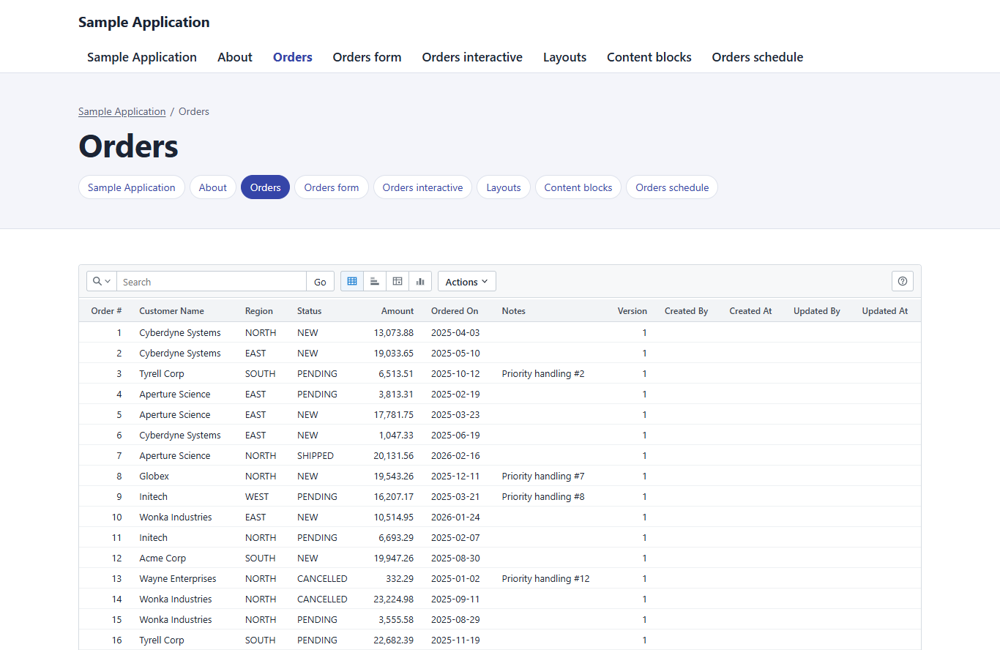

<h1 align="center">AppBlocks</h1>

<p align="center">
  Forms, reports and database-backed blocks for Umbraco.<br>
  Add them to the Block Grid or Block List you already have, alongside your Rich Text, on the pages you already have.
</p>

<p align="center">
  <a href="LICENSE"></a>
  
  
  
  
</p>



## What it is

AppBlocks gives Umbraco editors blocks that work with real application data. The site keeps its page types, templates, layout and sign-in. AppBlocks adds no page type or template of its own.

- **Sets itself up.** Install the package and start the site. Its definitions install through Umbraco's own services, with no import step or configuration.
- **Forms backed by your C#.** Add a Forms container to a page and bind it to a registered class. Your class owns persistence, validation and business rules, and the field pickers follow its fields. Attachments, editable tables and schedules are included.
- **Anti-spam without code.** Place a block in a public form to protect it with Turnstile, reCAPTCHA, hCaptcha or a honeypot, checked on the server before your class runs.
- **Interactive reports.** The optional **AppBlocks.InteractiveReports** package adds a block powered by [Interactive Reports](https://github.com/auroris/Interactive-Reports). Pick a table or write a SELECT, and readers can search, filter, sort, chart, save and download.
- **Documents and printing.** The optional **AppBlocks.Documents** package produces template-based HTML and PDF documents, with optional direct-to-printer output through [Pressroom](https://github.com/auroris/Pressroom).
- **Umbraco's access rules first.** Blocks follow their page's Public Access. Add group rules, row restrictions and C# policies only when a rule goes beyond the page.
- **Your own database.** Application data goes in a separate SQLite file by default, away from Umbraco's. Connect SQL Server, PostgreSQL or Oracle from the backoffice, with connection strings encrypted at rest.
- **Keeps working when it can't create tables.** If the database account isn't allowed to, the backoffice shows the grant or script to run, and everything else carries on.

This is an alpha targeting Umbraco **18.3** and **.NET 10**. No NuGet release has been created yet.

## Add it to a site

Install the locally built `AppBlocks` package, or reference `src/AppBlocks/AppBlocks.csproj` during development. Its Umbraco composer registers services, management screens and routes automatically. AppBlocks installs its embedded element and data type definitions directly through Umbraco's services on startup, preserving existing site definitions and their stable keys. Installation needs no synchronization package or import configuration. Missing definitions and their folders are installed in one transaction, so a failed installation can be retried on the next startup. Only fresh installs are supported; there is no schema upgrade or migration path. Data types and document/element types are grouped under **AppBlocks** in their respective backoffice trees, with subfolders for Forms, Data sources and Interactive Reports. These folders are created during installation on a fresh site. Install `AppBlocks.InteractiveReports` when the site needs interactive reports; NuGet brings in AppBlocks as its required dependency. Its composer adds report services and routes. See the [companion guide](src/AppBlocks.InteractiveReports/README.md).

1. In **Settings → Data Types**, add **Forms container** (and **Interactive Report** when its companion is installed) to the allowed blocks of your existing Block Grid or Block List. **HTML**, **CSS** and **JavaScript** are installed too, and offered nowhere until a site adds them to a grid of its own, because they run whatever an editor writes.
2. Configure application data sources in **Settings → AppBlocks → Connections** and create your application tables. **AppBlocks database** is available as `AppBlocksDb` by default.
3. Register a C# class implementing `IFormResource` with dependency injection (`AddScoped<IFormResource, YourFormClass>()`). Add a **Forms container** to any page, add a Form, and select the **Form class** in Form Interface. Field pickers use that class's fields; the class owns persistence, validation and authorization.
4. With `AppBlocks.InteractiveReports` installed, add an **Interactive Report** and choose **Table** or **SQL query**. Tables are listed as `DataSourceName.TableName` (including the schema where applicable). For SQL, select a configured data source and enter a SELECT query. Configure the starting view to save columns, sorting, filters, paging and presentation on that block. No data-source content nodes or report definition in `appsettings.json` are needed.

Sites using Umbraco's conventional `blockgrid/Components` or `blocklist/Components` partial rendering pick up the packaged components automatically. A site with its own rendering convention can invoke `AppBlocksBlock` with `block` (a `BlockGridItem`) or `listItem` (a `BlockListItem`). Pass `page` explicitly when rendering outside the current routed page.

```cshtml
@await Component.InvokeAsync("AppBlocksBlock", new { block = Model })
```

The native blocks include their required assets and inherit ordinary site typography. Public page content stays visible. On a page without Public Access an anonymous visitor reaches its interactive blocks, and whatever is behind each block decides: a C# form class with no check of its own is public, while the data source engine, tabular forms, schedules and paper reports show a sign-in notice until someone signs in. Interactive blocks also work for an authenticated Umbraco Member or backoffice User. `IDataSourceUserResolver` exposes the account type and current groups; the application decides who may read or change its data. Backoffice administrators receive no automatic application permissions. Umbraco Public Access still protects Member pages, and configured data-source Member Groups and application policies also apply to API requests. See the [identity and access examples](docs/business-rules.md#group-membership) and the Public contact form recipe there.

A page with an interactive block, and any response Public Access protects, depends on who asks, so it is sent `no-store` and stays out of ASP.NET Core's output cache if the site uses one. The blocks' `/api/` endpoints send `no-store` too but do not opt out, so keep them out of any output cache policy you add.

## Connections

**Settings → AppBlocks → Connections** supplies **AppBlocks database** (`AppBlocksDb`) as the default for forms and reports. On SQLite installations, its `AppBlocks.sqlite.db` file sits beside Umbraco's SQLite database. Application data, saved report views and uploaded file contents share this file by default. It is created on first use with foreign keys and write-ahead logging enabled. The site supplies its business tables; saved-report and upload tables are created by their stores, or by hand where the database account may not (see [Database setup](#database-setup)).

Use this separate database for application work. SQLite permits only one writer per database, so keeping form submissions and uploads out of Umbraco's file avoids competing with CMS saves. `UmbracoDb` remains available for sources that specifically read CMS data. AppBlocks opens its own connections; it does not share Umbraco's scope or transaction.

If Umbraco has no file-backed SQLite database, the default file is under `App_Data` in `AppBlocks:DataRoot`, or the site's content root when that is not set. A configured `ConnectionStrings:AppBlocksDb` and `ConnectionStrings:AppBlocksDb_ProviderName` override the default file and provider. Back up the application database as well as Umbraco's database, using a SQLite-aware backup when the application is running.

Uploads can use their own store by setting:

```json
{
  "Attachments": {
    "Connection": "AttachmentsDb"
  }
}
```

This selects the optional `Attachments.sqlite.db` beside Umbraco's SQLite file. Set `Attachments:Connection` to another registered SQLite or SQL Server connection to use another database, or configure `ConnectionStrings:AttachmentsDb` and its `_ProviderName` to override that optional store. Leave `Attachments:Connection` empty or use `AppBlocksDb` to share the default application database. Uploaded bytes are stored in database tables, not loose files. If the application database uses PostgreSQL or Oracle, select a separate supported upload store.

The reports companion defaults `InteractiveReport:SavedReports:Connection` to `AppBlocksDb`. An explicit `SavedReports:Connection` or `SavedReports:DataSource` takes precedence. See the [companion guide](src/AppBlocks.InteractiveReports/README.md).

Administrators can add, edit and test extra SQL Server, SQLite, PostgreSQL, **Oracle 11.2** or **Oracle 12+** connections. The screen links to [connection string examples](https://www.connectionstrings.com/). Report table choices come from database metadata; SQL queries are authored on the report block. Changing a connection selects a database; it does not copy existing tables or files.

Connection strings entered here are protected with ASP.NET Core Data Protection and stored in `App_Data/AppBlocks/connections.json`; they are never stored in blocks, returned by the listing API or included in content exports. Keep that file and the site's Data Protection keys together when backing up or moving an installation. Multiple application instances need a shared, durable file/key store; concurrent administration across multiple instances is not yet coordinated.

Register a site's business connections with `AddAppBlocks(connections => connections.AddConnection(...))`, or `AddApplicationDatabase` for a database with its own schema. Connections registered this way and those supplied by the site configuration are read-only in this screen, and forms, data sources and the report source picker offer them like any other. A registered connection has no connection string to show: its database type is the dialect passed to `AddConnection`, or else what its unopened connection's type says, and `unknown` for a custom connection type that declares no dialect. A saved connection of the same name keeps precedence and stays editable.

Connections added directly to Interactive Reports' builder through the companion's `AddAppBlocksInteractiveReports` are outside this list. Configured reports, report definition nodes and forms can still open one by name, but this screen does not show it and a report block refuses it.

**Oracle 11.2** and **Oracle 12+** are Oracle SQL compatibility modes shared with Interactive Reports. The choice controls the SQL generated for the connection. Both modes use the bundled `Oracle.ManagedDataAccess.Core` driver. For configured connections, set `ConnectionStrings:<name>_ProviderName` to `oracle11g` for Oracle 11.2 mode or `oracle` for Oracle 12+ mode; existing `Oracle.ManagedDataAccess.Client` and `Oracle.ManagedDataAccess.Core` provider names still work. Code registrations can pass `DatabaseDialect.Oracle11g` or `DatabaseDialect.Oracle` to `AddConnection`. Oracle 12+ mode also detects pre-12 server versions on first use and switches to Oracle 11.2 mode, as Interactive Reports does.

Oracle 11.2 mode uses 11.2-compatible metadata and row limits, with explicit key sequences for generated keys (`keySequences`, for example `{"ID":"ORDERS_SEQ"}`). Oracle 12+ mode additionally discovers identity columns. The reports companion preserves the selected compatibility mode. Upload storage still requires a separate SQLite or SQL Server connection.

The bundled driver matches Interactive Reports' live-test dependency. Oracle's [current driver certification](https://docs.oracle.com/en/database/oracle/oracle-database/26/odpnt/InstallSystemRequirements.html) lists Database 19c and later; connectivity to older servers requires verification independently of the selected SQL compatibility mode.

## Database setup

Forms and reports read the site's own tables and need nothing created. Two features keep tables of their own, and create them on first use when the database account may. **Settings → AppBlocks → Database setup** shows administrators each feature's connection, whether its tables are there, and both ways to set it up for that database type. Looking at the screen creates nothing, and it never shows a connection string.

| Feature | Tables | Connection | Without them |
| --- | --- | --- | --- |
| File uploads | `APP_ATTACHMENT`, `APP_ATTACHMENT_LINK` | `Attachments:Connection`, by default `AppBlocksDb` | Attachments blocks show a plain notice instead of files, and nothing can be uploaded. The form around them keeps working. |
| Saved report views (`AppBlocks.InteractiveReports`) | `IR_SAVED_REPORTS`, and `IR_ADMINISTRATORS` for the saved report administration page | `InteractiveReport:SavedReports`, by default `AppBlocksDb` | Saving views is hidden and reports open on their own starting view. Reports still load, query and export. |

Everything else keeps working in that state, and no visitor sees an error. An administrator who is signed in to the backoffice also gets a link to the setup screen. The reason is logged once as a warning, with what to do, rather than on every request.

There are two ways to set a feature up, and either takes effect on the next request, with no restart:

1. **Grant the permission**, so AppBlocks creates the tables itself. The screen prints the statements with the account's name in them.
   - **SQLite** has no accounts: the account the site runs under needs write access to the database file and its folder.
   - **SQL Server**: `CREATE TABLE`, plus `ALTER`, `SELECT`, `INSERT`, `UPDATE`, `DELETE` and `REFERENCES` on the account's default schema, which is where its tables land. That is `dbo` unless the database user says otherwise, and the screen names it. Tables in a schema belong to the schema's owner, not to the account that creates them, so this covers every table in that schema. To limit the account to these tables, use the script.
   - **PostgreSQL**: `USAGE` and `CREATE` on the account's current schema, which the screen names. The account owns what it creates.
   - **Oracle**: `CREATE TABLE` and `CREATE SEQUENCE`, plus `CREATE TRIGGER` on 11.2, and a quota on the account's tablespace. The account owns what it creates.
2. **Run the script**, viewable and downloadable on the screen, as an account that may create tables. The account the site signs in as then needs no right to create anything. The script is made from what AppBlocks itself runs, so the two cannot differ, and it is safe to run more than once. On SQL Server and PostgreSQL it ends by granting that account read and write on those tables. On SQL Server, run as the database's owner, the tables go in `dbo`, which SQL Server looks in after an account's default schema, so an account with a schema of its own still finds them. On PostgreSQL, an owner first sets `search_path` to the account's schema, as the script's header says. On Oracle, connect as the account, or as a DBA after `ALTER SESSION SET CURRENT_SCHEMA = <account>`, so that the tables are in its schema.

File uploads run on SQLite and SQL Server only. On PostgreSQL or Oracle the block shows the same notice and nothing is created: select a separate store with `Attachments:Connection`, as described under [Connections](#connections).

`APP_SCHEMA` is a bookkeeping table AppBlocks' schema code writes when it creates tables. Nothing reads it back, so uploads neither need it nor wait for it, and the script leaves it out. An account that may create tables gets one as before.

## Anti-spam

Editors protect a form with no code by placing an **Anti-spam** block inside it. The Forms container's grid offers it on plain sites, because unlike HTML it runs nothing an editor writes. They choose Cloudflare Turnstile, Google reCAPTCHA v2 or v3 (with a score threshold, 0.5 by default), hCaptcha, or a built-in honeypot that needs no account. The block renders the service's widget and script. AppBlocks checks every create and update on the server before the form's class is called, and a request can't leave the check out. A failed check returns a message to the visitor. If the service is unreachable or a key is missing, the submission is refused with a friendly message and the problem is logged once and shown on the settings screen.

Site keys are public and can go on the block. Secret keys stay on the server, in configuration (`AppBlocks:AntiSpam:<service>:SecretKey`) or encrypted in **Settings → AppBlocks → Anti-spam**. They are never in block content, exports, API responses or logs.

**Privacy.** Turnstile, reCAPTCHA and hCaptcha load third-party scripts in the visitor's browser and may need cookie consent on some sites. Consent handling stays with the site. A site with its own Content-Security-Policy has to allow the scripts. The honeypot loads nothing.

**This isn't a rate limit.** Anyone can still call a public form as often as they like, so a site exposed to the internet should also limit `/api/forms`. The Anti-spam section of the [business rules guide](docs/business-rules.md) has a short recipe for ASP.NET Core's rate limiter, along with the service details, the order of checks, the hosts a Content-Security-Policy needs and how to register another service. Form submissions are limited to 1 MB; `AppBlocks:Forms:MaxBodySize` changes that.

The tests stand in for the services and need no network. To try the real ones with the test keys each service publishes:

```powershell
dotnet run --project tests/AppBlocks.Tests -- -noLogo -explicit only -class AppBlocks.Tests.AntiSpamRealServiceTests
$env:APPBLOCKS_ANTISPAM_REAL = "1"; node --test tests/ui/anti-spam.browser.test.mjs
```

## Samples and business rules

**Settings → AppBlocks → Forms** discovers saved forms across native block properties, including nested containers, drafts and language variants. Each form links to a read-only C# sample and a `.cs` download. Samples reflect that form's writable fields and demonstrate parameterized reads and upserts with authorization and optimistic concurrency against a clearly named example SQLite table.

Shared recipes live in [business-rules.md](docs/business-rules.md), available under **Settings → AppBlocks → Business rules** with section navigation, copyable code examples and a Markdown download: signed-in identity, groups, ownership, trusted defaults, validation, transactions and other common business rules. Samples and the guide are reference material; the backoffice does not execute them or provide a code editor.

## Development and verification

AppBlocks builds without Interactive Reports. Its optional companion references it; source development for the companion uses a sibling `../Interactive-Reports` checkout when present. Override `InteractiveReportsRoot` when needed. Set `UseInteractiveReportsSource=false` to use NuGet dependencies, including when checking the release package against a local package feed.

```powershell
dotnet build AppBlocks.slnx
dotnet run --project tests/AppBlocks.Tests -- -noLogo
dotnet run --project tests/AppBlocks.InteractiveReports.Tests -- -noLogo
dotnet run --project tests/AppBlocks.Documents.Tests -- -noLogo
dotnet run --project samples/AppBlocks.Demo --urls http://localhost:5079
dotnet pack src/AppBlocks -c Release -o artifacts/packages
dotnet pack src/AppBlocks.InteractiveReports -c Release -o artifacts/packages
dotnet pack src/AppBlocks.Documents -c Release -o artifacts/packages
pwsh -NoProfile -File tests/clean-install/Invoke-CleanInstall.ps1
```

The demo references the reports companion, which brings in AppBlocks. The optional demo seed is website code, outside the package. Enable `AppBlocksDemo:SeedContent` in the demo's ignored `appsettings.Development.local.json` on a local SQLite installation to create a sample table and an ordinary article with a Block List and a Block Grid. Its own template uses both native rendering helpers. The companion's HTTP acceptance test can verify that running demo:

```powershell
$env:APPBLOCKS_DEMO_SETTINGS = "$PWD/samples/AppBlocks.Demo/appsettings.Development.local.json"
dotnet run --project tests/AppBlocks.InteractiveReports.Tests -- -noLogo
```

The seed and HTTP test are intended only for this disposable local demo. The local settings file is excluded from publishing. The test uses the unattended demo account from that file.

The [clean-install acceptance test](tests/clean-install/README.md) builds actual NuGet packages, installs them into fresh official Umbraco sites without uSync or other CMS plugins, and verifies installation, browser editing, data operations and restart behavior. Each run uses empty databases and its own package cache.

## Documents companion

Install `AppBlocks.Documents` for template-based HTML/PDF documents. It depends on AppBlocks and
works without Interactive Reports. Administrators configure the optional Pressroom service at
**Settings → AppBlocks → Documents**. Without Pressroom, documents open as self-contained HTML;
service failures fall back to HTML and are logged through Umbraco. Document actions open a new
window/tab. See [Documents configuration, authoring and integration](src/AppBlocks.Documents/README.md).

## Who owns the definitions

The `Schema/` folders of AppBlocks and its companions are the only source of their element and data types, the data source types and the report definition type. Change them there. Fresh sites install the complete current definitions. After a schema change, recreate the development or test site to use it; startup does not modify existing definitions. Optional child types are declared in the schema and included during installation when their companion package is present.

A site that imports definitions with a synchronization tool should call `SchemaInstaller.EnsureAsync`, which is resolvable from dependency injection and safe to run repeatedly, before its import starts: the installer's own startup notification can come after the import. UmbracoAppHost does that for uSync, and refuses to import copies of these definitions except the two it widens on purpose, listed in its `AppBlocksDefinitions.HostOwned`.

## Extraction compatibility

UmbracoAppHost consumes AppBlocks and the optional companions it needs. Its SSO, site shells and sample content remain in AppHost. Existing content keys, routes, element and editor aliases (including the `AppHost.*` editor UI aliases in stored definitions), configuration keys and table names are retained so a site's data keeps working. `AppBlockSchema.Key` still hashes the `UmbracoAppHost.Blocks.v1:` seed, because every stored key derives from it. Legacy configured reports and report-definition content continue to run, while new reports are configured directly on blocks.

AppBlocks includes forms, attachments, tabular editing and the schedule runtime. Interactive reports live in `AppBlocks.InteractiveReports`, which depends on AppBlocks. Existing callbacks typed as `Action<InteractiveReportBuilder>` move from `AddAppBlocks` to `AddAppBlocksInteractiveReports`; report definitions move from `PublishedDataCatalog` to the companion's `PublishedReportCatalog`. Public publishing, broader provider acceptance testing and API stabilization remain release work.

### Namespaces

Every C# namespace in this repository is `AppBlocks.*`, and no namespace spans two assemblies. Code written against the extracted packages under the old names changes as follows. A name in the third column moved separately from the rest of its old namespace.

| Old namespace | New namespace | Moved separately |
| --- | --- | --- |
| `UmbracoAppHost.Attachments` | `AppBlocks.Attachments` | |
| `UmbracoAppHost.Authentication` (`ApplicationAccessPolicy`) | `AppBlocks.Authentication` | Identity helpers; AppBlocks does not override Umbraco Public Access for administrators |
| `UmbracoAppHost.Blocks` | `AppBlocks.Blocks` | `AppReportDefinitionStore`, `ConfiguredReportStore`: `AppBlocks.InteractiveReports.Blocks` |
| `UmbracoAppHost.Databases` | `AppBlocks.Databases` | `ReportApplicationDatabases` is gone: register with `AppBlocksBuilder.AddApplicationDatabase` |
| `UmbracoAppHost.DataSources` | `AppBlocks.DataSources` | `PublishedReport`, `PublishedReportCatalog`, `PublishedReportValidator`, `DataSourceReportAccess`, `DataSourceReportBindings`, `DataSourceContextParameters`, `OriginalContextParameters`: `AppBlocks.InteractiveReports.DataSources` |
| `UmbracoAppHost.Forms` | `AppBlocks.Forms` | |
| `UmbracoAppHost.PaperReports` | `AppBlocks.Documents.PaperReports` | `PaperReportLinks`: `AppBlocks.DocumentOutput` |
| `UmbracoAppHost.Reports` | `AppBlocks.InteractiveReports.Reports` | AppHost's own `ReportAccessPolicy` stays in `UmbracoAppHost.Reports` |
| `UmbracoAppHost.Schedules` | `AppBlocks.Schedules` | |
| `UmbracoAppHost.Tabular` | `AppBlocks.Tabular` | |
| `UmbracoAppHost.Website` (`PageUpdateExtensions`, `PageCacheResponseFilter`, `ProtectedPageCacheHeaders`) | `AppBlocks.Publishing` | AppHost's own types, such as `SiteMenu`, stay in `UmbracoAppHost.Website` |
| `AppBlocks.Documents`, base assembly (`IAppDocumentLinks`, `IDocumentOutputService`, `DocumentRequest` and the other output types) | `AppBlocks.DocumentOutput` | The `AppBlocks.Documents` assembly's own types stay in `AppBlocks.Documents` |
| `AppBlocks`, companion assembly (`AppBlocksOptions`) | `AppBlocks.InteractiveReports` | The base assembly's `AppBlocksExtensions` stays in `AppBlocks` |

Also when updating a host of UmbracoAppHost:

- Razor views compile at run time there, so a build does not catch an old name. A start does not rewrite a host's `Views/_ViewImports.cshtml`. Change its `@inject UmbracoAppHost.Blocks.AppPageAssets PageAssets` to `@inject AppBlocks.Blocks.AppPageAssets PageAssets` and add `@using AppBlocks.Authentication` and `@using AppBlocks.Publishing`. Check every view of its own too, paper report views especially: `@using UmbracoAppHost.PaperReports` becomes `@using AppBlocks.Documents.PaperReports`.
- Connections go through `AppBlocksBuilder`. `IUmbracoAppHost.ConfigureReports` is now `ConfigureConnections(WebApplicationBuilder, AppBlocksBuilder)`, the callback of `AddUmbracoAppHost` takes an `AppBlocksBuilder`, and `TestSiteOptions.ConfigureReports` is `ConfigureConnections`. A `reports.AddApplicationDatabase(...)` call becomes `connections.AddApplicationDatabase(...)` with the same arguments. A host that also set other report options there moves them to a composer that calls `AddAppBlocksInteractiveReports`.
- `UmbracoAppHost:DataRoot` no longer applies to AppBlocks. AppHost sets `AppBlocks:DataRoot` to the same folder, unless a host has configured `AppBlocks:DataRoot` itself. A test or tool that configures AppBlocks services directly sets `AppBlocks:DataRoot`.

## License

[MIT](LICENSE)
