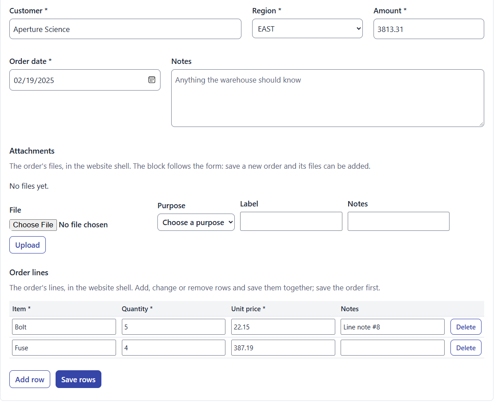

<h1 align="center">AppBlocks</h1>

  Forms, reports and database-backed blocks for Umbraco. 
  Add them to the Block Grid or Block List you already have, alongside your Rich Text, on the pages you already have.

  
  
  
  
  

## What it is

AppBlocks gives Umbraco editors blocks that work with real application data. The site keeps its page types, templates, layout and sign-in. AppBlocks adds no page type or template of its own.

- **Sets itself up.** Install the package and start the site. Its definitions install through Umbraco's own services, with no import step or configuration, and a new version updates them through Umbraco's package migrations. **Settings → AppBlocks → Definitions** can reset them to the package or remove them.
- **Forms backed by your C#.** Add a Forms container to a page and bind it to a registered class. Your class owns persistence, validation and business rules, and the field pickers follow its fields. Attachments, editable tables and schedules are included.
- **Anti-spam without code.** Place a block in a public form to protect it with Turnstile, reCAPTCHA, hCaptcha or a honeypot, checked on the server before your class runs.
- **Interactive reports.** The optional **AppBlocks.InteractiveReports** package adds a block powered by [Interactive Reports](https://github.com/auroris/Interactive-Reports). Pick a table or write a SELECT, and readers can search, filter, sort, chart, save and download.
- **Documents and printing.** The optional **AppBlocks.Documents** package produces template-based HTML and PDF documents, with optional direct-to-printer output through [Pressroom](https://github.com/auroris/Pressroom).
- **Umbraco's access rules first.** Blocks follow their page's Public Access. Add group rules, row restrictions and C# policies only when a rule goes beyond the page.
- **Your own database.** Application data goes in a separate SQLite file by default, away from Umbraco's. Connect SQL Server, PostgreSQL or Oracle from the backoffice, with connection strings encrypted at rest. SQLite and SQL Server drivers come with Umbraco; a site installs `Npgsql` or `Oracle.ManagedDataAccess.Core` for the others.
- **Keeps working when it can't create tables.** If the database account isn't allowed to, the backoffice shows the grant or script to run, and everything else carries on.

This is an alpha targeting Umbraco **18.3** and **.NET 10**. No NuGet release has been created yet.

## Quick start

AppBlocks isn't on NuGet yet, so reference `src/AppBlocks/AppBlocks.csproj` or install a locally built package. It registers itself and installs its definitions on startup. Add `AppBlocks.InteractiveReports` for reports and `AppBlocks.Documents` for documents, each of which brings in AppBlocks.

1. In **Settings → Data Types**, add **Forms container** (and **Interactive Report** when its companion is installed) to the allowed blocks of your existing Block Grid or Block List. **HTML**, **CSS** and **JavaScript** are installed too, and offered nowhere until a site adds them to a grid of its own, because they run whatever an editor writes.
2. Configure application data sources in **Settings → AppBlocks → Connections** and create your application tables. **AppBlocks database** is available as `AppBlocksDb` by default.
3. Register a C# class implementing `IFormResource` with dependency injection (`AddScoped<IFormResource, YourFormClass>()`). Add a **Forms container** to any page, add a Form, and select the **Form class** in Form Interface. Field pickers use that class's fields; the class owns persistence, validation and authorization.
4. With `AppBlocks.InteractiveReports` installed, add an **Interactive Report** and choose **Table** or **SQL query**. Tables are listed as `DataSourceName.TableName` (including the schema where applicable). For SQL, select a configured data source and enter a SELECT query. Configure the starting view to save columns, sorting, filters, paging and presentation on that block. No data-source content nodes or report definition in `appsettings.json` are needed.

Sites using Umbraco's conventional `blockgrid/Components` or `blocklist/Components` partials pick up the packaged components automatically. [Adding AppBlocks to a site](docs/site-integration.md) covers other rendering conventions, what anonymous visitors can do, and caching.

**Check your form classes before putting them on a public page.** On a page without Public Access, an anonymous visitor reaches your class, so a class with no check of its own is public. The [business rules guide](docs/business-rules.md) has the checks, and a recipe for a public contact form.

## Documentation

| Guide | What it covers |
| --- | --- |
| [Adding AppBlocks to a site](docs/site-integration.md) | Installation, rendering, access and caching |
| [Business rules](docs/business-rules.md) | Identity, groups, ownership, validation, and authorization scenarios. Also under **Settings → AppBlocks → Business rules** |
| [Connections](docs/connections.md) | The default database, extra connections, upload storage and Oracle modes |
| [Database setup](docs/database-setup.md) | The tables AppBlocks creates, and what to do when the database account may not |
| [Anti-spam](docs/anti-spam.md) | The Anti-spam block, its keys, privacy and rate limits |
| [Shuttle field](docs/shuttle.md) | Two lists, ordered selections, and single-line CSV values |
| [Schedule block](docs/schedule.md) | Rows, bars, markers across the top, colours, descriptions and the window |
| [Color picker](docs/color-picker.md) | Hex color fields, defaults, clearing and validation |
| [Worked example: a multi-tenant activity schedule](docs/activity-schedule-example.md) | The page tree, tables, data sources, blocks and C# of one application, end to end |
| [Interactive Reports companion](src/AppBlocks.InteractiveReports/README.md) | Report blocks, saved views and report access |
| [Documents companion](src/AppBlocks.Documents/README.md) | HTML and PDF documents, and printing through Pressroom |
| [Developing AppBlocks](docs/developing.md) | Building, testing, the demo and who owns the definitions |
| [Migrating from UmbracoAppHost](docs/migrating-from-umbracoapphost.md) | Old and new namespaces, and what changes for hosts |

**Settings → AppBlocks → Forms** also lists every saved form, each with a read-only C# sample to download.

## License

[MIT](LICENSE)
